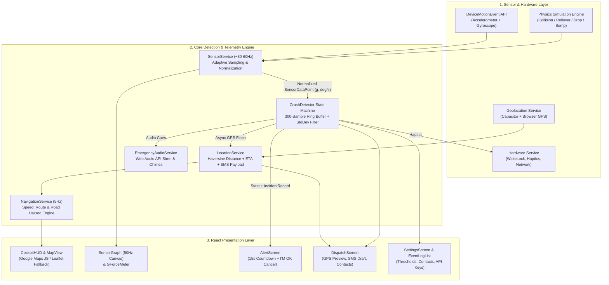
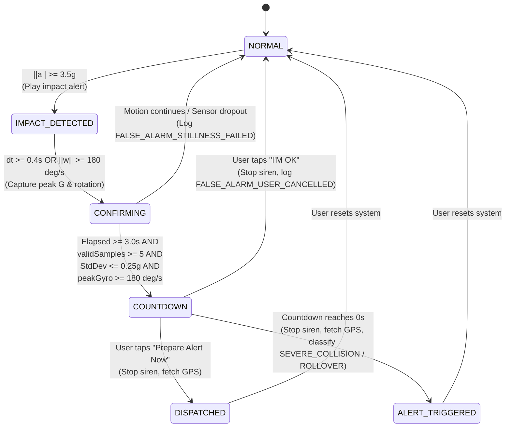
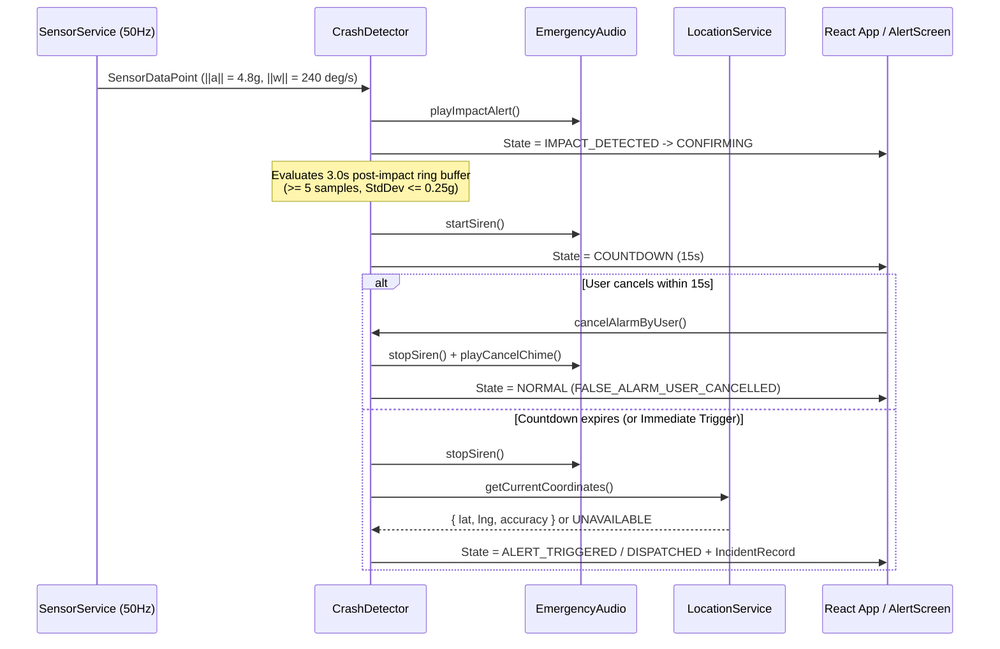

# AccidentGuard

**Experimental Smartphone-Based Crash Detection, Telemetry HUD & Location-Aware Emergency Alert Prototype**

[](https://github.com/HiiAliasgar/Accident-Guard/actions/workflows/ci.yml)
[](https://github.com/HiiAliasgar/Accident-Guard/actions/workflows/deploy.yml)
[](./LICENSE)

AccidentGuard is a cross-platform road safety prototype built with **React, TypeScript, Vite, and Capacitor (Android)**. It processes live 3-axis accelerometer and gyroscope telemetry through a multi-stage crash-detection state machine, filters out common false positives (such as phone drops and speed bumps), and prepares a location-aware emergency alert workflow.

> **Important Safety Notice:** AccidentGuard is an experimental student/hackathon prototype—not a certified automotive safety product. It does not automatically contact emergency services, ambulances, or hospitals, and must never be relied upon in a real-world emergency.

**[Live Web Demo](https://hiialiasgar.github.io/Accident-Guard/)** · **[Privacy Policy](./PRIVACY_POLICY.md)**

---

## System Architecture



---

## Crash Detection State Machine



---

## End-to-End Emergency Data Flow



---

## Key Features

- **Multi-Stage Crash Detection Engine:** Combines resultant G-force magnitude ($\|a\| = \sqrt{x^2 + y^2 + z^2}$), 3-axis gyroscope tumbling ($\|\omega\| = \sqrt{lpha^2 + eta^2 + \gamma^2}$), and a 300-sample circular ring buffer computing post-impact standard deviation to reject phone drops and road bumps.
- **Real-Time 50Hz Canvas Oscilloscope:** Zero-GC `Float32Array` ring buffer rendering X, Y, Z, and resultant magnitude waveforms alongside a live G-Force gauge.
- **Interactive Physics Testbench:** Test `HEAD_ON_COLLISION`, `ROLLOVER_CRASH`, `PHONE_DROP_REJECTION`, and `SPEED_BUMP_POTHOLE` through the real detection pipeline.
- **Dual-Engine Navigation HUD:** Cockpit speedometer, road hazard alerts, and interactive map supporting both **Google Maps Platform** (optional API key) and **Leaflet / OpenStreetMap** (zero-config fallback).
- **Honest Emergency Alert Preview:** Generates a structured SMS draft with verified GPS coordinates (or explicit `UNAVAILABLE` status—never fabricated coordinates) and lets the user review before sending.
- **Adaptive Sampling & Hardware Support:** Supports iOS/Android `DeviceMotionEvent` permissions, Screen WakeLock, native Capacitor Haptics, and 30Hz/60Hz adaptive polling.

---

## Detection Thresholds & Rationale

| Parameter | Default | Role |
|---|---|---|
| `impactThresholdG` | `3.5g` | Entry trigger from `NORMAL` to `IMPACT_DETECTED` |
| `stillnessDurationSec` | `3.0s` | Post-impact observation window in `CONFIRMING` |
| `stillnessVarianceG` | `0.25g` | Max post-impact standard deviation to classify as stationary (requires ≥ 5 samples) |
| `gyroTumbleThresholdDegPerSec` | `180°/s` | Rotational corroboration during impact window |
| `ROLLOVER_GYRO_THRESHOLD` | `300°/s` | Distinguishes `ROLLOVER` from `SEVERE_COLLISION` |
| `countdownDurationSec` | `15s` | User abort window before `ALERT_TRIGGERED` |

---

## Repository Structure

```text
Accident-Guard/
├── .github/workflows/       # CI (unit tests, web build, Android debug APK) & GitHub Pages deploy
├── android/                 # Capacitor native Android project
├── public/                  # PWA manifest, service worker, icons, privacy policy
├── src/
│   ├── components/          # UI views (CockpitHUD, MapView, SensorGraph, AlertScreen, DispatchScreen, SettingsScreen, ...)
│   ├── services/            # Core logic (crashDetector, sensorService, locationService, navigationService, audioService, hardwareService, googleMapsService)
│   ├── types/               # Shared TypeScript interfaces & state machine types
│   ├── App.tsx              # Application shell, state orchestration & tab routing
│   ├── main.tsx             # Entry point & React ErrorBoundary
│   └── index.css            # Dark-mode automotive HUD design system
├── capacitor.config.ts      # Capacitor configuration
├── package.json             # Dependencies & scripts
├── tsconfig.json            # TypeScript strict configuration
└── vite.config.ts           # Vite bundler & chunk-splitting config
```

---

## Local Development & Testing

### Prerequisites
- Node.js 20+ and npm
- (Optional) Android Studio / JDK 21 for native Android builds

### Commands

```bash
# 1. Install dependencies
npm install

# 2. Run automated unit tests (Vitest)
npm test

# 3. Type-check and build production bundle
npm run build

# 4. Start local development server
npm run dev
```

### Testing Real Phone Sensors
Modern mobile browsers require **HTTPS** for `DeviceMotionEvent` and Geolocation APIs. Push to GitHub with GitHub Pages enabled (`.github/workflows/deploy.yml`), open the HTTPS link on your phone, and tap the **Sim (50Hz)** pill in the top bar to switch to **Hardware** sensors.

---

## Known Limitations

- Thresholds (`3.5g` impact, `180°/s` tumble, `300°/s` rollover, `0.25g` stillness StdDev) are experimental heuristics and have not been validated against NHTSA/SAE crash datasets.
- Hospital entries are demonstration fixtures and not verified trauma centers.
- No backend emergency dispatch integration exists; SMS and call intents require explicit user action.
- Background execution when the browser tab is closed or the OS sleeps is limited by web platform constraints.

## License

MIT — see [LICENSE](./LICENSE).
